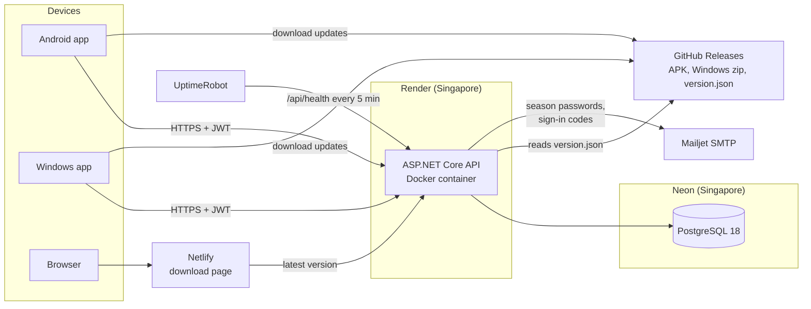

# STI eVoter: Technical Documentation

STI eVoter is the student election system of STI College Legazpi. It has three parts:

| Part | Repository | What it is |
|---|---|---|
| **App** | [`sti_legazpi_evoter`](https://github.com/PlayerOne-bit/sti_legazpi_evoter) (this repo) | Flutter app for Android and Windows, used by both students and admins. |
| **Server** | [`sti_legazpi_evoter_backend`](https://github.com/PlayerOne-bit/sti_legazpi_evoter_backend) | ASP.NET Core Web API with a PostgreSQL database. All rules and data live here. |
| **Download page** | `download-site/` in this repo | Static landing page at https://sti-legazpi-evoter.netlify.app |

For day-to-day use and releasing, see [README.md](README.md). For running and maintaining the server, see the backend's README.

---

## 1. Architecture



- **The app holds no data.** It is a client: every screen loads from the API, and every rule is enforced on the server. A modified app cannot vote twice or vote outside a season.
- **The server is stateless.** Uploaded photos and the encryption keys are stored in the database, so the container can be rebuilt or moved without losing anything.
- **Time comes from the server.** The app syncs its clock offset from `serverTime` on every load, so countdowns and voting windows ignore the phone's clock.

---

## 2. Tech stack

### App (this repo)

| Area | Choice |
|---|---|
| Framework | **Flutter 3.47** (stable), **Dart 3** |
| Platforms shipped | Android (APK, min SDK 21) and Windows 10/11 (64-bit zip) |
| UI | Material 3, custom theme with STI blue and yellow, light and dark mode, Plus Jakarta Sans via `google_fonts` |
| State | One app-wide `ChangeNotifier` (`AppState` in `lib/data/mock.dart`) with `ListenableBuilder` in the screens. No state-management package. |
| Networking | `http` with a small wrapper (`lib/data/api.dart`): base URL, JWT header, error messages, server clock sync |
| Files | `file_picker` for Excel import and candidate photos; a built-in square cropper for photos |
| Self-update | `package_info_plus` (current version) and `crypto` (SHA-256 check of the downloaded file) |
| App icon | `flutter_launcher_icons` from `assets/logo.jpg` |

### Server (backend repo)

| Area | Choice |
|---|---|
| Framework | **ASP.NET Core 10** Web API (C#, .NET 10), controllers + services |
| Database access | **Entity Framework Core 10** with **Npgsql** (PostgreSQL provider), code-first migrations applied on start |
| Database | **PostgreSQL 18** |
| Authentication | JWT bearer tokens (`Microsoft.AspNetCore.Authentication.JwtBearer`). Roles: `student` and `admin`; student tokens carry the one season they may open. |
| Passwords | Admin passwords: ASP.NET Identity `PasswordHasher` (salted hashes). Season passwords: encrypted with ASP.NET **Data Protection**, keys kept in the database (`DataProtection.EntityFrameworkCore`). |
| Excel | **ClosedXML** (writing templates, voter lists, results) and **ExcelDataReader** (reading `.xls` and `.xlsx` imports) |
| Email | .NET SMTP client to Mailjet |
| Protection | Rate limiting on sign-in (10 attempts per minute per address), CORS limited to the download page, forwarded headers for the proxy |
| Packaging | **Docker** (`Dockerfile`, .NET 10 SDK to build, ASP.NET runtime to run, time zone Asia/Manila) |
| Local tools | Visual Studio 2026, user secrets, `StiEvoter.Api.http` request file |

### Download page

Plain **HTML, CSS and JavaScript**, no framework or build step. `app.js` asks the API for the latest version and fills in the download buttons; `history.js` holds the version history.

### Tooling

| Tool | Used for |
|---|---|
| Git and **GitHub** | Source code for both repos, and **GitHub Releases** for app downloads |
| **GitHub CLI** (`gh`) | Publishing releases from `scripts/build_release.ps1` |
| PowerShell | Release and keystore scripts |
| Android SDK / Gradle | Building and signing the APK |
| Visual Studio (C++ workload) | Building the Windows app |

---

## 3. Services

All services run on free plans.

| Service | Role | Details |
|---|---|---|
| **Render** | Hosts the API | Free web service `sti-evoter-api` in Singapore, built from the `Dockerfile` via `render.yaml`. Redeploys automatically on every push to the backend's `master` branch. Provides HTTPS. Settings (database URL, keys, email) are environment variables in Render. |
| **Neon** | PostgreSQL database | Serverless PostgreSQL 18 in AWS Singapore, branch `production`. Sleeps after about 5 minutes without queries and wakes on the next one. Holds all data, uploaded photos (`StoredFiles`) and encryption keys (`DataProtectionKeys`). |
| **Netlify** | Download page | Publishes `download-site/` from this repo on every push (`netlify.toml`). Sets security headers. |
| **GitHub Releases** | App files | Each release (`v1.0.8` and so on) holds the APK, the Windows zip and `version.json` with versions, sizes and SHA-256 hashes. The API reads `version.json` from the newest release. |
| **Mailjet** | Email | SMTP on port 2525 (Render's free plan blocks the usual ports). Sends season passwords to `lastname.XXXXXX@legazpi.sti.edu.ph` and admin sign-in codes. Requires a sender on a verified domain. |
| **Cloudflare** | Domain email (planned) | Email Routing to forward replies for the sender domain to Gmail, and DNS records (SPF, DKIM, DMARC) for Mailjet. |
| **UptimeRobot** | Keep-awake | Calls `/api/health` every 5 minutes so the free Render service does not sleep. It does not touch the database, so Neon can still sleep. |

### Free-plan limits that shaped the design

- **Render has no lasting disk**, so photos and keys are stored in PostgreSQL instead of files.
- **Render sleeps after 15 minutes**, so UptimeRobot pings a health check that skips the database.
- **Neon counts compute hours**, so cleanup jobs run only before real requests (at most once a minute) rather than on a timer that would keep the database awake.
- **Mailjet free** allows about 200 emails a day; sending stops after 5 failures in a row and reports why.

---

## 4. App structure

```
sti_legazpi_evoter/
├── lib/
│   ├── main.dart                 App start, theme
│   ├── theme.dart                Colors (light/dark), text styles, date formats
│   ├── data/
│   │   ├── api.dart              HTTP client, JWT, server clock offset, errors
│   │   ├── mock.dart             AppState: models (Election, Student, Candidate...) and all API calls
│   │   ├── app_update.dart       Checks for a new version, downloads and verifies it
│   │   ├── excel_io.dart         Excel import/export through the API
│   │   ├── admin_accounts.dart   Admin account and admin list calls
│   │   └── candidate_images.dart Candidate photo upload/remove
│   ├── screens/
│   │   ├── auth.dart             Sign-in (student/admin), seasons preview, 2-step code, update check
│   │   ├── result_screen.dart    Results and polls
│   │   ├── client/               Student home and the voting flow
│   │   └── admin/                Dashboard, Seasons, Candidates, Party lists, Voters,
│   │                             Students, History, Admins, Winners
│   └── widgets/                  Shared pieces: season cards, date range calendar,
│                                 candidate cards, vote stepper, cropper, update dialog
├── assets/                       Logo (also the app icon)
├── android/  windows/            Platform projects (iOS, macOS, Linux, web exist but are not shipped)
├── download-site/                Netlify landing page (index.html, styles.css, app.js, history.js)
├── scripts/
│   ├── build_release.ps1         Builds APK + Windows zip, checks them, publishes a GitHub release
│   └── create_keystore.ps1       One-time Android signing key
├── netlify.toml                  Netlify settings
├── README.md                     User guide, releasing, update history
└── DOCUMENTATION.md              This file
```

### Server structure (backend repo)

```
sti_legazpi_evoter_backend/
├── StiEvoter.Api/
│   ├── Program.cs        Services, JWT, CORS, rate limits, data protection, migrations on start
│   ├── Controllers/      Endpoints: Auth, Client (students), Admin* (seasons, candidates,
│   │                     voters, students, Excel, history, admins), PublicSeasons, AppUpdate, Uploads
│   ├── Services/         Business rules: seasons, ballots, tallies, voter rosters, passwords,
│   │                     email, Excel, stored files, housekeeping
│   ├── Models/           Database tables (Entities.cs)
│   ├── Dtos/             Request and response shapes
│   ├── Data/             AppDbContext, first-run seeding
│   └── Migrations/       EF Core migrations
├── Dockerfile            Container build used by Render
├── render.yaml           Render blueprint
└── README.md             Maintenance guide
```

### Data model

| Table | Holds |
|---|---|
| `Students`, `GradeLevels`, `Programs` | Students with number, full name, level, program, section, school year, active flag |
| `Admins` | Admin accounts, super admin flag, optional email for two-step sign-in |
| `Clubs`, `Elections`, `ElectionGradeLevels` | Seasons: club, school year, voting window, who may vote |
| `Positions`, `Candidates`, `PartyLists` | Ballot content, ranked positions, photos and party logos |
| `SeasonVoters` | Each season's voter list with an encrypted password per student |
| `ElectionVoters` | **Who** voted (student and season) |
| `Ballots`, `BallotChoices` | **What** was chosen, with no student id, so votes stay secret |
| `Histories`, `HistoryWinners` | Closed seasons and their winners |
| `StoredFiles`, `DataProtectionKeys` | Uploaded images and encryption keys |

---

## 5. Main flows

**Student sign-in and voting**
1. The admin creates a season. The server builds its voter list from active students in the chosen grade levels and gives each a random password.
2. Passwords are emailed (Mailjet) or exported to Excel.
3. The student signs in with student number and password. The server finds the season that password belongs to and issues a token for that season only.
4. The ballot shows one position per page. On submit, the server checks the season is open, the student is eligible and has not voted, and there is one choice per position. It saves the "voted" mark and the anonymous ballot together in one database save.
5. When the admin closes the season, the server tallies, stores the winners in History, and the results appear in the app.

**Automatic housekeeping** (server, before season and student requests, at most once a minute)
- Deletes seasons that reach their opening time with no candidates.
- Marks students inactive when their school year has ended (June, Philippine time).

**App updates**
1. `scripts/build_release.ps1` builds both platforms, checks the Windows build starts, writes `version.json` with SHA-256 hashes and publishes a GitHub release.
2. The API reads `version.json` from the newest release (cached 5 minutes) and answers `GET /api/app/update`.
3. The app checks on the sign-in screen, downloads the file, verifies its SHA-256 hash and installs it: through the Android installer, or on Windows by replacing the app's files from the new zip. The download page uses the same endpoint for its buttons.

---

## 6. Security summary

- Every rule is enforced on the server; the app is never trusted for time, eligibility or vote counts.
- Secret ballot: who voted and what they chose are stored in separate tables with no link.
- Season passwords are random, separate per season, and encrypted at rest; admin passwords are salted hashes.
- Student tokens open one season only. Admin tokens are separate; only the super admin manages admins and edits student details.
- Optional two-step sign-in for admins by email code.
- Sign-in rate limiting, HTTPS everywhere, CORS limited to the download page.
- Downloaded updates are checked against the SHA-256 hash published with the release.

---

## 7. How it was made

| When (2026) | Milestone |
|---|---|
| Oct 20 – 25 | Flutter project started; screens and UI built first as a prototype with sample data |
| Oct 26 | ASP.NET Core API and PostgreSQL added; the app switched from sample data to the API |
| Nov 3 – 11 | Excel import/export; season and winner screens |
| Nov 15 – 17 | Season passwords, password management, deleting and resetting history |
| Nov 20 – 22 | Super admin and admin roles, candidate photos with cropping |
| Nov 23 | Dark mode, school years, active/inactive students, party lists with colors and logos, ranked positions |
| Nov 24 | Production setup: Docker, in-app updates, Netlify download page |
| Nov 25 | Hosting on Render + Neon, email through Mailjet, GitHub Releases. Versions 1.0.0 to 1.0.8: app icon, seasons on the sign-in screen, range calendar, locked open seasons, season-bound sign-in, automatic housekeeping, landscape layouts, student editing |

**Approach**
- **UI first.** The screens were designed and tested with sample data before the server existed, so the flows could be tried early. The state class still lives in `lib/data/mock.dart` from that stage, though it now talks to the API.
- **Rules on the server.** Once the API was added, every check (one vote, open season, eligibility, locking) moved to the server so the app cannot be used to cheat.
- **Free hosting by design.** Render, Neon, Netlify, GitHub Releases and Mailjet were chosen so the system runs at no cost. Their limits shaped the design (see section 3).
- **Small, frequent releases.** Each change is pushed and released through one script; installed apps update themselves from the sign-in screen.

The full list of changes per version is in the **Update history** in [README.md](README.md) and on the download page.
